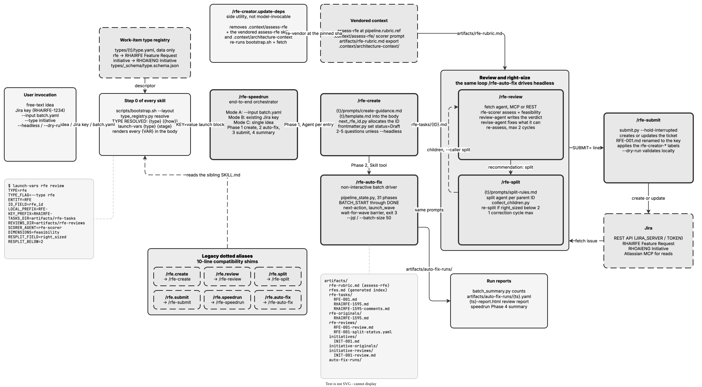

<!-- Auto-generated from registry.yaml. Do not edit directly. -->


# rfe-creator

rfe-creator turns a problem statement into a tracked, reviewed Jira work item
without a human writing the ticket. Since 0.2.0 it is **type-generic**: one
pipeline serves every registered work-item type — RFEs in the RHAIRFE project
by default, Initiatives in RHAISTRAT with `--type initiative` — instead of a
separate skill set per type. Each type is a data-only descriptor at
`types/<type>/type.yaml`, and every skill body renders its paths, labels,
rubric, size rules and review dimensions from the `launch-vars` block that
`scripts/type_registry.py` prints for the resolved type. Adding a type is a
descriptor, not a fork of the skills.

Six skills make the pipeline. `/rfe-create` interviews you (or runs
`--headless` from a batch) and writes the item. `/rfe-review` scores it against
the type's rubric, runs the type's review dimensions — technical feasibility
for RFEs, feasibility plus strategic alignment for Initiatives — and
auto-revises what fails, over at most two re-assessment cycles. `/rfe-split`
decomposes an oversized item into right-sized children and reviews them, with
one self-correction cycle. `/rfe-submit` writes to Jira through the REST API.
`/rfe-auto-fix` drives the same work over whole batches as a non-interactive
state machine — it re-runs the very same agent prompt files rather than
calling the skills — and `/rfe-speedrun` chains create → auto-fix → submit end
to end. A seventh skill, `/rfe-creator.update-deps`, re-vendors the pinned
assess-rfe rubric and the architecture context.

The orchestrating skills never read item bodies into their own context. They
launch background agents for all content-heavy work and communicate with them
only through files on disk: frontmatter via `scripts/frontmatter.py`, run state
via `scripts/state.py`, and completion via polling `check_review_progress.py`.
That is what lets a batch run survive context compression — every ID list,
cycle counter and flag is re-read from `tmp/` rather than remembered.

The legacy dotted commands (`/rfe.create` and friends) still work. Since 0.2.0
they are ten-line compatibility aliases that bootstrap the layout and then
delegate to their generic sibling, so they have no workflow of their own.


!!! info "Plugin Details"

    - **Version**: 0.3.0
    - **Author**: fullsend-ai
    - **Category**: [Product Planning](../../categories/planning.md)
    - **Repository**: [fullsend-ai/rfe-creator](https://github.com/fullsend-ai/rfe-creator)
    - **Tags**: <span class="tag-pill">rfe</span> <span class="tag-pill">initiative</span> <span class="tag-pill">jira</span> <span class="tag-pill">review</span> <span class="tag-pill">pipeline</span>

## Pipeline

<div class="diagram-container" markdown>

</div>

## Skills

| Skill | Description | Invocable |
|-------|-------------|-----------|
| [`/rfe-create`](rfe-create.md) | Write a new work item of any registered type — an RFE from a problem statement, idea, or need (business needs, WHAT/WHY), or an Initiative from an objective or strategic goal (/rfe-create --type initiative ...). Asks clarifying questions, then produces well-formed items. Use when starting from scratch. | :material-check: |
| [`/rfe-review`](rfe-review.md) | Review and improve work items of any registered type — RFEs (RHAIRFE) and Initiatives (RHAISTRAT, /rfe-review --type initiative). Accepts one or more Jira keys to fetch and review existing items, or reviews local artifacts from /rfe-create. Runs rubric scoring and the type's review dimensions (technical feasibility, strategic alignment), then auto- revises the issues it finds. | :material-check: |
| [`/rfe-split`](rfe-split.md) | Split oversized work items of any registered type — RFEs and Initiatives — into smaller, right-sized ones. Takes one or more IDs of items already in the workspace (fetched by /rfe-review or written by /rfe-create; e.g. /rfe-split RHAIRFE-1234 RHAIRFE-5678, /rfe- split --type initiative INIT-001) and skips an ID with no local task file. Runs non- interactively — decomposes, generates new items, reviews them, self-corrects, and checks coverage. | :material-check: |
| [`/rfe-submit`](rfe-submit.md) | Submit or update work items of any registered type in Jira — new RHAIRFE tickets for new RFEs, RHAISTRAT Initiative tickets for Initiatives (/rfe-submit --type initiative), or updates to existing tickets fetched from Jira. Use after /rfe-review. | :material-check: |
| [`/rfe-speedrun`](rfe-speedrun.md) | End-to-end pipeline for work items of any registered type — RFEs by default, Initiatives with --type initiative. Accepts a single idea, Jira key(s), or a YAML batch file. Creates, reviews, auto-fixes (with splits), and submits. Supports --headless, --announce-complete, and --dry-run for CI. | :material-check: |
| [`/rfe-auto-fix`](rfe-auto-fix.md) | Review and fix batches of work items automatically — RFEs by default, any registered type with --type (e.g. --type initiative). Accepts explicit IDs or a JQL query. Reviews, auto- revises, and splits oversized items. Non-interactive. | :material-check: |
| [`/rfe.create`](rfe.create.md) | Compatibility alias for /rfe-create, kept so existing /rfe.create invocations keep working. Write a new RFE: prefer /rfe-create (Initiatives: /rfe-create --type initiative). | :material-check: |
| [`/rfe.review`](rfe.review.md) | Compatibility alias for /rfe-review, kept so existing /rfe.review invocations keep working. Review, improve and auto-revise RFEs: prefer /rfe-review (Initiatives: /rfe- review --type initiative). | :material-check: |
| [`/rfe.split`](rfe.split.md) | Compatibility alias for /rfe-split, kept so existing /rfe.split invocations keep working. Split oversized RFEs: prefer /rfe-split (Initiatives: /rfe-split --type initiative). | :material-check: |
| [`/rfe.submit`](rfe.submit.md) | Compatibility alias for /rfe-submit, kept so existing /rfe.submit invocations keep working. Submit or update RFEs in Jira: prefer /rfe-submit (Initiatives: /rfe-submit --type initiative). | :material-check: |
| [`/rfe.speedrun`](rfe.speedrun.md) | Compatibility alias for /rfe-speedrun, kept so existing /rfe.speedrun invocations keep working. End-to-end RFE pipeline: prefer /rfe-speedrun (Initiatives: /rfe-speedrun --type initiative). | :material-check: |
| [`/rfe.auto-fix`](rfe.auto-fix.md) | Compatibility alias for /rfe-auto-fix, kept so existing /rfe.auto-fix invocations keep working. Batch review, revision and split of RFEs: prefer /rfe-auto-fix (Initiatives: /rfe-auto-fix --type initiative). | :material-check: |
| [`/rfe-creator.update-deps`](rfe-creator.update-deps.md) | Update vendored dependencies | :material-check: |

## Installation

**Claude Code**

```bash
/plugin install rfe-creator@opendatahub-skills
```

**OpenAI Codex** — add the marketplace, then enable `rfe-creator` from the `/plugins` browser:

```bash
codex plugin marketplace add opendatahub-io/skills-registry
```

## Architecture

**Type resolution.** Every skill's Step 0 resolves the work-item type
(`type_registry.py resolve`) and then prints a launch block
(`type_registry.py launch-vars <type> <stage>`). Each `{VAR}` in a skill body —
`{TASKS_DIR}`, `{REVIEWS_DIR}`, `{ID_FIELD}`, `{DIMENSIONS}`, `{STATE_PREFIX}`,
`{SCORER_AGENT}` — is a line in that block, and the whole block is prepended to
every agent prompt. The `{STATE_PREFIX}` (empty for RFEs, `initiative-` for
Initiatives) keeps concurrent runs of different types from colliding in `tmp/`.

**Layout check.** A marketplace install has no `scripts/` or `types/` in the
working directory, so each skill runs `scripts/bootstrap.sh --layout` once
through its own plugin path to link them in. Thereafter every command in the
body runs verbatim as a relative path — the headless permission allowlist
matches command text literally, so absolute paths would be denied.

**Orchestrator / agent split.** `/rfe-review`, `/rfe-split` and `/rfe-auto-fix`
are orchestrators: they launch opus background agents (fetch, assess, dimension,
review, revise, split) and read back only structured frontmatter. The contract
between them is the filesystem — an agent is "done" when its output file exists
and parses, which `check_review_progress.py` polls with a script-supplied
`NEXT_POLL` backoff.

**State machine.** `/rfe-auto-fix` is not a caller of the other skills — its
`allowed-tools` is `Bash, Agent`, so it has no Skill tool at all. It is a
second, headless implementation of the same work that launches agents directly
against the same prompt files — `.claude/skills/rfe-review/prompts/*.md` for
the review waves, and the typed descriptor paths
`types/<type>/dimensions/*.md` and `types/<type>/prompts/split-rules.md` for
the dimension and split waves — replacing the hand-rolled polling with
`scripts/pipeline_state.py`, a 31-phase machine (`BATCH_START` → `FETCH` →
`SETUP` → `ASSESS` → `REVIEW` → `REVISE` → `FIXUP` → the `REASSESS_*` block →
`COLLECT` → the `SPLIT_*` block → `BATCH_DONE` → `ERROR_COLLECT` → `REPORT` →
`DONE`). The skill loops on `next-action`, executes `run_script` or
`launch_wave`, and blocks on `wait-for-wave`; a `Stop` hook re-enters the loop
if a turn ends before `DONE`.

**Scoring.** The rubric comes from the assess-rfe plugin, vendored by
`scripts/bootstrap.sh` at the commit the descriptors pin
(`pipeline.rubric.ref`, one shared value both types must agree on) and exported
to `artifacts/rfe-rubric.md`. `/rfe-create` reads it to shape its questions so
what it writes will pass.

**Jira.** Writes go through `scripts/submit.py` over the REST API with Basic
Auth — `JIRA_SERVER`, `JIRA_USER` and `JIRA_TOKEN` (a Jira API token) — rather
than the MCP server, so the call sequence is deterministic rather
than dependent on tool-calling decisions. Reads prefer the Atlassian MCP server
and fall back to `scripts/fetch_issue.py`.
