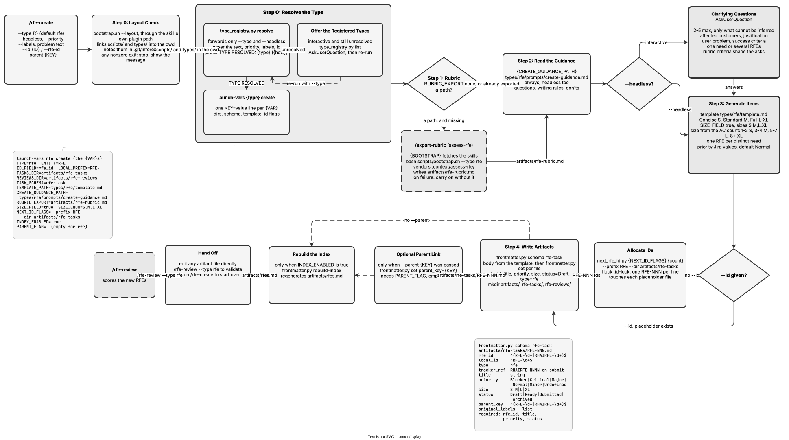

<!-- Auto-generated from registry.yaml. Do not edit directly. -->


# rfe-create

Writes a new work item from a problem statement, idea or objective — an RFE
capturing business needs (WHAT and WHY) by default, an Initiative with
`--type initiative`. It resolves the type, loads the type's rubric
(bootstrapping and exporting it if absent), reads the type's creation
guidance, and asks at most 2-5 clarifying questions — only what it cannot
infer from the input. `--headless` skips the questions but still reads the
guidance.

Items are written from the type's template to `{TASKS_DIR}/<ID>.md`. IDs are
allocated atomically by `next_rfe_id.py` unless `--id` pre-assigned one, and
all frontmatter is set through `frontmatter.py set` against the type's
schema — never written by hand. For a type that sizes its items, the Size
Guide assigns S/M/L/XL from the acceptance-criteria count.

**Plugin**: [rfe-creator](index.md) | **:material-check: User-invocable**

## Contract

<div class="skill-contract">
  <header class="skill-contract__header">
    <span class="skill-contract__eyebrow">Skill Contract</span>
    <span class="skill-contract__version">canonical-skill-v1</span>
  </header>
  <p class="skill-contract__lede">Turn a problem statement, idea or objective into a well-formed work item of the resolved type — an RFE describing business needs (WHAT and WHY) by default, an Initiative with --type initiative — sized and ready for review.</p>
  <section class="skill-contract__section" data-section="01">
    <h3 class="skill-contract__section-title"><span class="skill-contract__section-name">Identity</span></h3>
    <div class="skill-contract__row">
      <span class="skill-contract__field">Functions</span>
      <div class="skill-contract__inline">
        <span class="skill-contract__chip skill-contract__chip--function">generate</span>
      </div>
    </div>
    <div class="skill-contract__row">
      <span class="skill-contract__field">Success</span>
      <ul class="skill-contract__list">
        <li>Produces a well-formed item of the resolved type, sized by the type&#x27;s rules (S/M/L/XL from acceptance-criteria count for RFEs).</li>
        <li>Writes the type&#x27;s task file (artifacts/rfe-tasks/RFE-NNN.md, artifacts/initiatives/INIT-NNN.md) with valid frontmatter and rebuilds the index when the type keeps one.</li>
      </ul>
    </div>
  </section>
  <section class="skill-contract__section" data-section="02">
    <h3 class="skill-contract__section-title"><span class="skill-contract__section-name">Optimization Targets</span></h3>
    <div class="skill-contract__metrics">
      <div class="skill-contract__metric">
        <code class="skill-contract__metric-id">task_success</code>
        <span class="skill-contract__measure skill-contract__measure--judge">judge</span>
        <a class="skill-contract__ref" href="https://github.com/fullsend-ai/rfe-creator/blob/c6eb99de1e6c474fbabc9bbcf98d03734dfbefd2/.claude/skills/rfe-create/SKILL.md" title="fullsend-ai/rfe-creator@c6eb99de1e6c474fbabc9bbcf98d03734dfbefd2:.claude/skills/rfe-create/SKILL.md">SKILL.md @ c6eb99d<span class="skill-contract__ref-arrow" aria-hidden="true">&#x2192;</span></a>
      </div>
    </div>
  </section>
  <section class="skill-contract__section" data-section="03">
    <h3 class="skill-contract__section-title"><span class="skill-contract__section-name">Invariants</span></h3>
    <div class="skill-contract__row">
      <span class="skill-contract__field">Must Preserve</span>
      <ul class="skill-contract__list">
        <li>Describe needs and outcomes (WHAT and WHY) only — never prescribe architecture or implementation.</li>
        <li>Use Jira priority values (Blocker/Critical/Major/Normal/Minor), never High/Medium/Low.</li>
        <li>Take every typed literal (template, guidance, dirs, id prefix) from the type registry&#x27;s launch block — never hand-write a typed path.</li>
      </ul>
    </div>
    <div class="skill-contract__row">
      <span class="skill-contract__field">Fixed Context</span>
      <div class="skill-contract__code">
      <div class="skill-contract__code-line"><span class="skill-contract__code-key">tools</span><span class="skill-contract__code-val">Read, Write, Edit, Glob, Grep, Bash, AskUserQuestion</span></div>
      <div class="skill-contract__code-line"><span class="skill-contract__code-key">cli</span><span class="skill-contract__code-val">python3</span></div>
      <div class="skill-contract__code-line"><span class="skill-contract__code-key">knowledge</span><span class="skill-contract__code-val">repository_content<span class="skill-contract__privacy">public</span>, task_input<span class="skill-contract__privacy">task_private</span>, tool_output<span class="skill-contract__privacy">task_private</span></span></div>
      </div>
    </div>
  </section>
  <section class="skill-contract__section" data-section="04">
    <h3 class="skill-contract__section-title"><span class="skill-contract__section-name">Traceability</span></h3>
    <div class="skill-contract__row">
      <span class="skill-contract__field">Skill</span>
      <div class="skill-contract__inline"><a class="skill-contract__path" href="https://github.com/fullsend-ai/rfe-creator/blob/c6eb99de1e6c474fbabc9bbcf98d03734dfbefd2/.claude/skills/rfe-create/SKILL.md"><span class="skill-contract__ref-arrow" aria-hidden="true">&#x2197;</span><code>.claude/skills/rfe-create/SKILL.md</code></a></div>
    </div>
    <div class="skill-contract__row">
      <span class="skill-contract__field">Supporting</span>
      <ul class="skill-contract__paths">
        <li><a class="skill-contract__path" href="https://github.com/fullsend-ai/rfe-creator/blob/c6eb99de1e6c474fbabc9bbcf98d03734dfbefd2/types/rfe/template.md"><span class="skill-contract__ref-arrow" aria-hidden="true">&#x2197;</span><code>types/rfe/template.md</code></a></li>
        <li><a class="skill-contract__path" href="https://github.com/fullsend-ai/rfe-creator/blob/c6eb99de1e6c474fbabc9bbcf98d03734dfbefd2/types/rfe/prompts/create-guidance.md"><span class="skill-contract__ref-arrow" aria-hidden="true">&#x2197;</span><code>types/rfe/prompts/create-guidance.md</code></a></li>
        <li><a class="skill-contract__path" href="https://github.com/fullsend-ai/rfe-creator/blob/c6eb99de1e6c474fbabc9bbcf98d03734dfbefd2/types/initiative/template.md"><span class="skill-contract__ref-arrow" aria-hidden="true">&#x2197;</span><code>types/initiative/template.md</code></a></li>
        <li><a class="skill-contract__path" href="https://github.com/fullsend-ai/rfe-creator/blob/c6eb99de1e6c474fbabc9bbcf98d03734dfbefd2/types/initiative/prompts/create-guidance.md"><span class="skill-contract__ref-arrow" aria-hidden="true">&#x2197;</span><code>types/initiative/prompts/create-guidance.md</code></a></li>
      </ul>
    </div>
  </section>
</div>

## Diagram

<div class="diagram-container" markdown>

</div>

## Arguments

```bash
/rfe-create [--type <t>] [--headless] [--priority <value>] [--labels <csv>] [--id <ID>] [--parent <KEY>] <problem statement>
```

| Argument | Required | Default | Description |
|----------|----------|---------|-------------|
| `problem statement` | :material-check: | - | The idea, need or objective to turn into a work item. Free text, taken from whatever arguments remain after the flags. |
| `--type` |  | `rfe` | Work-item type to create. An explicit --type always wins over inference. |
| `--headless` |  | - | Ask no clarifying questions — generate the item directly from the input. The type's guidance is still read. |
| `--priority` |  | `Normal` | Override the default priority. Jira values only — never High/Medium/Low. |
| `--labels` |  | - | Labels to apply to the created item. |
| `--id` |  | - | Use this pre-assigned ID instead of allocating one. The placeholder file already exists. --rfe-id / --initiative-id are accepted as aliases. |
| `--parent` |  | - | Parent key to set on the created item. Offered only for a type whose batch entries carry parent_key — PARENT_FLAG is empty for rfe, so in practice this is the Initiative type. |

## Usage

```bash
/rfe-create Users need to verify model signatures at serving time
/rfe-create --type initiative Establish a trusted model supply chain for RHOAI
/rfe-create --headless --priority Critical --labels candidate-3.5 TrustyAI operator crashes on large clusters
```
