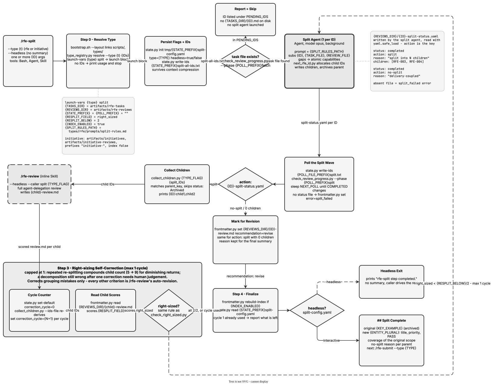

<!-- Auto-generated from registry.yaml. Do not edit directly. -->


# rfe-split

Decomposes an oversized work item into right-sized children that together
cover the original scope. It takes IDs already in the workspace — fetched by
`/rfe-review` or written by `/rfe-create` — and skips any ID with no local
task file.

It runs non-interactively. A split agent per parent applies the type's own
decomposition rules (`{SPLIT_RULES_PATH}`) and writes
`{REVIEWS_DIR}/<ID>-split-status.yaml`; a parent whose status says
`no-split` (delivery-coupled, say) has its recommendation set back to
`revise` so downstream consumers don't keep treating it as pending.
Children are collected and handed to `/rfe-review` as an inline headless
call.

One self-correction cycle follows: any child scoring below half the type's
`resplit` threshold on `right_sized` is split again and its children
reviewed. It stops there by design — repeated re-splitting compounds the
child count for diminishing returns, so a decomposition still wrong after
one correction needs human judgement. The loop corrects grouping mistakes
only; every other criterion is `/rfe-review`'s auto-revision to fix.

**Plugin**: [rfe-creator](index.md) | **:material-check: User-invocable**

## Contract

<div class="skill-contract">
  <header class="skill-contract__header">
    <span class="skill-contract__eyebrow">Skill Contract</span>
    <span class="skill-contract__version">canonical-skill-v1</span>
  </header>
  <p class="skill-contract__lede">Decompose an oversized work item of the resolved type into right-sized children that together cover the original scope.</p>
  <section class="skill-contract__section" data-section="01">
    <h3 class="skill-contract__section-title"><span class="skill-contract__section-name">Identity</span></h3>
    <div class="skill-contract__row">
      <span class="skill-contract__field">Functions</span>
      <div class="skill-contract__inline">
        <span class="skill-contract__chip skill-contract__chip--function">transform</span>
      </div>
    </div>
    <div class="skill-contract__row">
      <span class="skill-contract__field">Success</span>
      <ul class="skill-contract__list">
        <li>Decomposes an oversized item into right-sized children that cover all of the original scope.</li>
        <li>Reviews the children through /rfe-review and archives the parent.</li>
      </ul>
    </div>
  </section>
  <section class="skill-contract__section" data-section="02">
    <h3 class="skill-contract__section-title"><span class="skill-contract__section-name">Optimization Targets</span></h3>
    <div class="skill-contract__metrics">
      <div class="skill-contract__metric">
        <code class="skill-contract__metric-id">task_success</code>
        <span class="skill-contract__measure skill-contract__measure--judge">judge</span>
        <a class="skill-contract__ref" href="https://github.com/fullsend-ai/rfe-creator/blob/43ee4ae3c982ffe927aeaebbdb6723a668c08072/.claude/skills/rfe-split/SKILL.md" title="fullsend-ai/rfe-creator@43ee4ae3c982ffe927aeaebbdb6723a668c08072:.claude/skills/rfe-split/SKILL.md">SKILL.md @ 43ee4ae<span class="skill-contract__ref-arrow" aria-hidden="true">&#x2192;</span></a>
      </div>
    </div>
  </section>
  <section class="skill-contract__section" data-section="03">
    <h3 class="skill-contract__section-title"><span class="skill-contract__section-name">Invariants</span></h3>
    <div class="skill-contract__row">
      <span class="skill-contract__field">Must Preserve</span>
      <ul class="skill-contract__list">
        <li>Preserve full coverage of the original scope across the children.</li>
        <li>Limit right-sizing self-correction to one cycle, and re-split only for right-sizing.</li>
      </ul>
    </div>
    <div class="skill-contract__row">
      <span class="skill-contract__field">Fixed Context</span>
      <div class="skill-contract__code">
      <div class="skill-contract__code-line"><span class="skill-contract__code-key">tools</span><span class="skill-contract__code-val">Glob, Bash, Agent, Skill, AskUserQuestion</span></div>
      <div class="skill-contract__code-line"><span class="skill-contract__code-key">cli</span><span class="skill-contract__code-val">python3</span></div>
      <div class="skill-contract__code-line"><span class="skill-contract__code-key">knowledge</span><span class="skill-contract__code-val">repository_content<span class="skill-contract__privacy">public</span>, task_input<span class="skill-contract__privacy">task_private</span>, tool_output<span class="skill-contract__privacy">task_private</span></span></div>
      </div>
    </div>
  </section>
  <section class="skill-contract__section" data-section="04">
    <h3 class="skill-contract__section-title"><span class="skill-contract__section-name">Traceability</span></h3>
    <div class="skill-contract__row">
      <span class="skill-contract__field">Skill</span>
      <div class="skill-contract__inline"><a class="skill-contract__path" href="https://github.com/fullsend-ai/rfe-creator/blob/43ee4ae3c982ffe927aeaebbdb6723a668c08072/.claude/skills/rfe-split/SKILL.md"><span class="skill-contract__ref-arrow" aria-hidden="true">&#x2197;</span><code>.claude/skills/rfe-split/SKILL.md</code></a></div>
    </div>
    <div class="skill-contract__row">
      <span class="skill-contract__field">Supporting</span>
      <ul class="skill-contract__paths">
        <li><a class="skill-contract__path" href="https://github.com/fullsend-ai/rfe-creator/blob/43ee4ae3c982ffe927aeaebbdb6723a668c08072/types/rfe/prompts/split-rules.md"><span class="skill-contract__ref-arrow" aria-hidden="true">&#x2197;</span><code>types/rfe/prompts/split-rules.md</code></a></li>
        <li><a class="skill-contract__path" href="https://github.com/fullsend-ai/rfe-creator/blob/43ee4ae3c982ffe927aeaebbdb6723a668c08072/types/initiative/prompts/split-rules.md"><span class="skill-contract__ref-arrow" aria-hidden="true">&#x2197;</span><code>types/initiative/prompts/split-rules.md</code></a></li>
      </ul>
    </div>
  </section>
</div>

## Diagram

<div class="diagram-container" markdown>

</div>

## Arguments

```bash
/rfe-split [--type <t>] [--headless] <ID> [ID2 ...]
```

| Argument | Required | Default | Description |
|----------|----------|---------|-------------|
| `ID` | :material-check: | - | One or more space-separated IDs of items already in the workspace. An ID with no local task file is reported and skipped. |
| `--type` |  | `rfe` | Work-item type to split. An explicit --type always wins. |
| `--headless` |  | - | Suppress the end-of-run summary and emit a completion marker instead. |

## Usage

```bash
/rfe-split RHAIRFE-1234
/rfe-split RHAIRFE-1234 RHAIRFE-5678
/rfe-split --type initiative INIT-001
```
