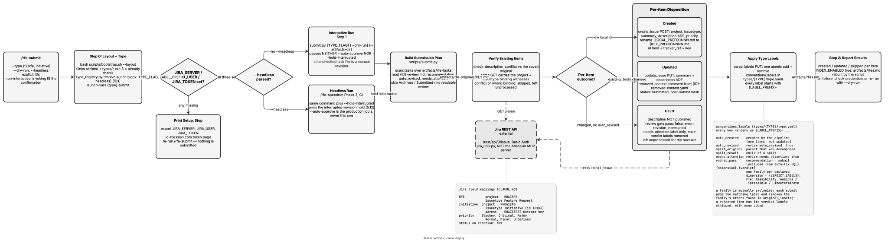

<!-- Auto-generated from registry.yaml. Do not edit directly. -->


# rfe-submit

Creates or updates the type's Jira tickets from reviewed artifacts — new
RHAIRFE tickets for RFEs, RHOAIENG Initiative tickets for Initiatives, or
updates to tickets already fetched from Jira.

Submission goes through `scripts/submit.py` against the Jira REST API with
Basic Auth (`JIRA_SERVER`, `JIRA_USER`, `JIRA_TOKEN`), not the MCP server,
so the exact call sequence is deterministic rather than dependent on
tool-calling decisions. On submit, `RFE-NNN.md` is renamed to its Jira key
— along with its companion files and its review file — and `tracker_ref`
and `type` are written into the task and review frontmatter.

The skill is deliberately non-interactive — invoking it is the confirmation,
so it does not ask again. A headless invocation (the `/rfe-speedrun` Phase 3
handoff, or CI) adds `--hold-interrupted`, which holds back any item whose
body changed while its review never recorded `auto_revised`, rather than
publishing it. The scripts apply the type's label family automatically:
`auto_created`, `auto_revised`, `split_original`, `split_result`,
`needs_attention`, `rubric_pass`, and one mutually-exclusive
`<dimension>.<verdict>` label per declared review dimension. Those are the
descriptor *keys*; the string actually pushed to Jira is the key's value in
`conventions.labels`, each prefixed `<LABEL_PREFIX>-` (for RFEs,
`rfe-creator-feasibility-pass`, `rfe-creator-autofix-rubric-pass`, …).

**Plugin**: [rfe-creator](index.md) | **:material-check: User-invocable**

## Contract

<div class="skill-contract">
  <header class="skill-contract__header">
    <span class="skill-contract__eyebrow">Skill Contract</span>
    <span class="skill-contract__version">canonical-skill-v1</span>
  </header>
  <p class="skill-contract__lede">Create or update Jira tickets of the resolved type — RHAIRFE for RFEs, RHOAIENG Initiatives with --type initiative — from reviewed artifacts using deterministic REST API calls.</p>
  <section class="skill-contract__section" data-section="01">
    <h3 class="skill-contract__section-title"><span class="skill-contract__section-name">Identity</span></h3>
    <div class="skill-contract__row">
      <span class="skill-contract__field">Functions</span>
      <div class="skill-contract__inline">
        <span class="skill-contract__chip skill-contract__chip--function">execute</span>
      </div>
    </div>
    <div class="skill-contract__row">
      <span class="skill-contract__field">Success</span>
      <ul class="skill-contract__list">
        <li>Creates or updates the type&#x27;s Jira tickets from the reviewed artifacts.</li>
        <li>Applies pipeline-outcome labels and rebuilds the index when the type keeps one.</li>
      </ul>
    </div>
  </section>
  <section class="skill-contract__section" data-section="02">
    <h3 class="skill-contract__section-title"><span class="skill-contract__section-name">Optimization Targets</span></h3>
    <div class="skill-contract__metrics">
      <div class="skill-contract__metric">
        <code class="skill-contract__metric-id">task_success</code>
        <span class="skill-contract__measure skill-contract__measure--deterministic">deterministic</span>
        <span class="skill-contract__ref-placeholder"></span>
      </div>
    </div>
  </section>
  <section class="skill-contract__section" data-section="03">
    <h3 class="skill-contract__section-title"><span class="skill-contract__section-name">Invariants</span></h3>
    <div class="skill-contract__row">
      <span class="skill-contract__field">Must Preserve</span>
      <ul class="skill-contract__list">
        <li>Route all Jira writes through the deterministic Python scripts (REST plus Basic Auth), not LLM tool-calling.</li>
        <li>Keep the type&#x27;s verdict-label families mutually exclusive.</li>
      </ul>
    </div>
    <div class="skill-contract__row">
      <span class="skill-contract__field">Fixed Context</span>
      <div class="skill-contract__code">
      <div class="skill-contract__code-line"><span class="skill-contract__code-key">tools</span><span class="skill-contract__code-val">Read, Write, Edit, Glob, Grep, Bash</span></div>
      <div class="skill-contract__code-line"><span class="skill-contract__code-key">cli</span><span class="skill-contract__code-val">python3</span></div>
      <div class="skill-contract__code-line"><span class="skill-contract__code-key">knowledge</span><span class="skill-contract__code-val">repository_content<span class="skill-contract__privacy">public</span>, task_input<span class="skill-contract__privacy">task_private</span>, tool_output<span class="skill-contract__privacy">task_private</span></span></div>
      </div>
    </div>
  </section>
  <section class="skill-contract__section" data-section="04">
    <h3 class="skill-contract__section-title"><span class="skill-contract__section-name">Traceability</span></h3>
    <div class="skill-contract__row">
      <span class="skill-contract__field">Skill</span>
      <div class="skill-contract__inline"><a class="skill-contract__path" href="https://github.com/fullsend-ai/rfe-creator/blob/main/.claude/skills/rfe-submit/SKILL.md"><span class="skill-contract__ref-arrow" aria-hidden="true">&#x2197;</span><code>.claude/skills/rfe-submit/SKILL.md</code></a></div>
    </div>
  </section>
</div>

## Diagram

<div class="diagram-container" markdown>

</div>

## Arguments

```bash
/rfe-submit [--type <t>] [--dry-run] [--headless] [ID ...]
```

| Argument | Required | Default | Description |
|----------|----------|---------|-------------|
| `ID` |  | - | Explicit item IDs to submit. With none given, the script submits the reviewed artifacts that are ready. |
| `--type` |  | `rfe` | Work-item type to submit. An explicit --type always wins. |
| `--dry-run` |  | - | Validate locally and skip all Jira writes. |
| `--headless` |  | - | Non-interactive invocation — adds --hold-interrupted so an item edited outside the pipeline is held for a human instead of published. |

## Usage

```bash
/rfe-submit
/rfe-submit --dry-run
/rfe-submit --type initiative INIT-001
```
