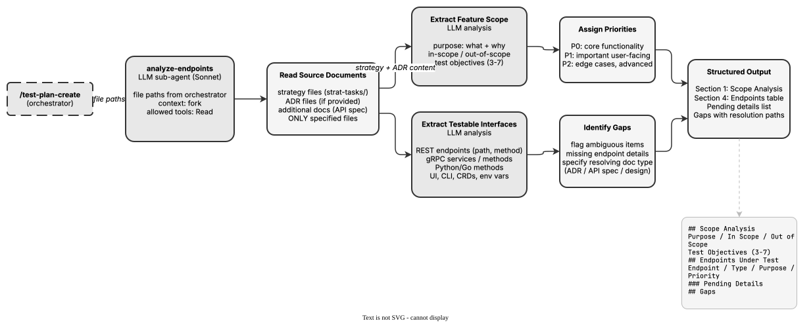

<!-- Auto-generated from registry.yaml. Do not edit directly. -->


# test-plan-analyze-endpoints

Internal forked sub-analyzer. Extracts feature scope (in-scope, out-of-scope,
test objectives) and identifies API endpoints, gRPC services, Python/Go methods,
UI components, CLI commands, and configuration interfaces under test. Assigns
priorities and reports gaps. Produces findings for Sections 1 and 4 of the test plan.

**Plugin**: [test-plan](index.md) | **:material-close: Internal**

## Contract

<div class="skill-contract">
  <header class="skill-contract__header">
    <span class="skill-contract__eyebrow">Skill Contract</span>
    <span class="skill-contract__version">canonical-skill-v1</span>
  </header>
  <p class="skill-contract__lede">Extract test scope, objectives and interfaces from the supplied strategy and optional design documents.</p>
  <section class="skill-contract__section" data-section="01">
    <h3 class="skill-contract__section-title"><span class="skill-contract__section-name">Identity</span></h3>
    <div class="skill-contract__row">
      <span class="skill-contract__field">Functions</span>
      <div class="skill-contract__inline">
        <span class="skill-contract__chip skill-contract__chip--function">analyze</span>
      </div>
    </div>
    <div class="skill-contract__row">
      <span class="skill-contract__field">Success</span>
      <ul class="skill-contract__list">
        <li>Returns scope, test objectives, interfaces and explicit gaps for missing interface details.</li>
        <li>Traces objectives to the acceptance-criteria identifiers in the source.</li>
      </ul>
    </div>
  </section>
  <section class="skill-contract__section" data-section="02">
    <h3 class="skill-contract__section-title"><span class="skill-contract__section-name">Optimization Targets</span></h3>
    <div class="skill-contract__metrics">
      <div class="skill-contract__metric">
        <code class="skill-contract__metric-id">task_success</code>
        <span class="skill-contract__measure skill-contract__measure--judge">judge</span>
        <a class="skill-contract__ref" href="https://github.com/fullsend-ai/test-creator/blob/d13995efb9bdc5b88a2c20e7f864a26fdf9ee9a0/skills/test-plan-analyze-endpoints/SKILL.md" title="fullsend-ai/test-creator@d13995efb9bdc5b88a2c20e7f864a26fdf9ee9a0:skills/test-plan-analyze-endpoints/SKILL.md">SKILL.md @ d13995e<span class="skill-contract__ref-arrow" aria-hidden="true">&#x2192;</span></a>
      </div>
    </div>
  </section>
  <section class="skill-contract__section" data-section="03">
    <h3 class="skill-contract__section-title"><span class="skill-contract__section-name">Invariants</span></h3>
    <div class="skill-contract__row">
      <span class="skill-contract__field">Must Preserve</span>
      <ul class="skill-contract__list">
        <li>Read only the supplied source documents and preserve acceptance-criteria numbering verbatim.</li>
        <li>Do not invent endpoint paths or interface details; record missing information as gaps.</li>
      </ul>
    </div>
    <div class="skill-contract__row">
      <span class="skill-contract__field">Fixed Context</span>
      <div class="skill-contract__code">
      <div class="skill-contract__code-line"><span class="skill-contract__code-key">documents</span><span class="skill-contract__code-val">skills/test-plan-analyze-endpoints/SKILL.md</span></div>
      <div class="skill-contract__code-line"><span class="skill-contract__code-key">knowledge</span><span class="skill-contract__code-val">task_input<span class="skill-contract__privacy">task_private</span></span></div>
      </div>
    </div>
  </section>
  <section class="skill-contract__section" data-section="04">
    <h3 class="skill-contract__section-title"><span class="skill-contract__section-name">Traceability</span></h3>
    <div class="skill-contract__row">
      <span class="skill-contract__field">Skill</span>
      <div class="skill-contract__inline"><a class="skill-contract__path" href="https://github.com/fullsend-ai/test-creator/blob/d13995efb9bdc5b88a2c20e7f864a26fdf9ee9a0/skills/test-plan-analyze-endpoints/SKILL.md"><span class="skill-contract__ref-arrow" aria-hidden="true">&#x2197;</span><code>skills/test-plan-analyze-endpoints/SKILL.md</code></a></div>
    </div>
  </section>
</div>

## Diagram

<div class="diagram-container" markdown>

</div>

## Usage

```bash
/test-plan-analyze-endpoints
```
