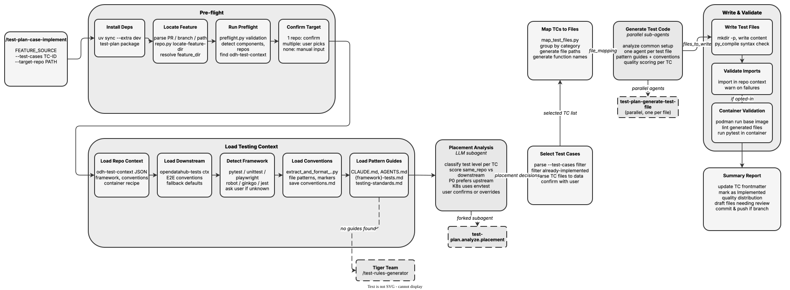

<!-- Auto-generated from registry.yaml. Do not edit directly. -->


# test-plan-case-implement

Generate executable test automation code (pytest, Go, Jest, etc.) from TC-*.md
test case specifications. Runs placement analysis to determine component repo vs
downstream E2E repo placement, loads repository conventions from odh-test-context,
generates test files in parallel via sub-agents, scores quality with a 5-criteria
rubric, and auto-revises low-scoring functions. Supports selective implementation
via --test-cases flag.

**Plugin**: [test-plan](index.md) | **:material-check: User-invocable**

## Contract

<div class="skill-contract">
  <header class="skill-contract__header">
    <span class="skill-contract__eyebrow">Skill Contract</span>
    <span class="skill-contract__version">canonical-skill-v1</span>
  </header>
  <p class="skill-contract__lede">Implement backend test-case specifications as executable pytest code in the selected target test repository.</p>
  <section class="skill-contract__section" data-section="01">
    <h3 class="skill-contract__section-title"><span class="skill-contract__section-name">Identity</span></h3>
    <div class="skill-contract__row">
      <span class="skill-contract__field">Functions</span>
      <div class="skill-contract__inline">
        <span class="skill-contract__chip skill-contract__chip--function">generate</span>
      </div>
    </div>
    <div class="skill-contract__row">
      <span class="skill-contract__field">Success</span>
      <ul class="skill-contract__list">
        <li>Maps cases to destination files, collects complete generated files and writes only the planned destinations.</li>
        <li>Updates test-case automation metadata with the implementation results.</li>
      </ul>
    </div>
  </section>
  <section class="skill-contract__section" data-section="02">
    <h3 class="skill-contract__section-title"><span class="skill-contract__section-name">Optimization Targets</span></h3>
    <div class="skill-contract__metrics">
      <div class="skill-contract__metric">
        <code class="skill-contract__metric-id">task_success</code>
        <span class="skill-contract__measure skill-contract__measure--judge">judge</span>
        <a class="skill-contract__ref" href="https://github.com/fullsend-ai/test-creator/blob/d13995efb9bdc5b88a2c20e7f864a26fdf9ee9a0/skills/test-plan-score-test-function/prompts/score-test-function.md" title="fullsend-ai/test-creator@d13995efb9bdc5b88a2c20e7f864a26fdf9ee9a0:skills/test-plan-score-test-function/prompts/score-test-function.md">score-test-function.md @ d13995e<span class="skill-contract__ref-arrow" aria-hidden="true">&#x2192;</span></a>
      </div>
    </div>
  </section>
  <section class="skill-contract__section" data-section="03">
    <h3 class="skill-contract__section-title"><span class="skill-contract__section-name">Invariants</span></h3>
    <div class="skill-contract__row">
      <span class="skill-contract__field">Must Preserve</span>
      <ul class="skill-contract__list">
        <li>Skip TC-UI cases and preserve existing target test code.</li>
        <li>Inspect repository code without importing target repository dependencies.</li>
      </ul>
    </div>
    <div class="skill-contract__row">
      <span class="skill-contract__field">Fixed Context</span>
      <div class="skill-contract__code">
      <div class="skill-contract__code-line"><span class="skill-contract__code-key">documents</span><span class="skill-contract__code-val">skills/test-plan-case-implement/SKILL.md, scripts/map_test_files.py, skills/test-plan-score-test-function/prompts/score-test-function.md</span></div>
      <div class="skill-contract__code-line"><span class="skill-contract__code-key">knowledge</span><span class="skill-contract__code-val">task_input<span class="skill-contract__privacy">task_private</span></span></div>
      </div>
    </div>
  </section>
  <section class="skill-contract__section" data-section="04">
    <h3 class="skill-contract__section-title"><span class="skill-contract__section-name">Traceability</span></h3>
    <div class="skill-contract__row">
      <span class="skill-contract__field">Skill</span>
      <div class="skill-contract__inline"><a class="skill-contract__path" href="https://github.com/fullsend-ai/test-creator/blob/d13995efb9bdc5b88a2c20e7f864a26fdf9ee9a0/skills/test-plan-case-implement/SKILL.md"><span class="skill-contract__ref-arrow" aria-hidden="true">&#x2197;</span><code>skills/test-plan-case-implement/SKILL.md</code></a></div>
    </div>
    <div class="skill-contract__row">
      <span class="skill-contract__field">Supporting</span>
      <ul class="skill-contract__paths">
        <li><a class="skill-contract__path" href="https://github.com/fullsend-ai/test-creator/blob/d13995efb9bdc5b88a2c20e7f864a26fdf9ee9a0/scripts/map_test_files.py"><span class="skill-contract__ref-arrow" aria-hidden="true">&#x2197;</span><code>scripts/map_test_files.py</code></a></li>
        <li><a class="skill-contract__path" href="https://github.com/fullsend-ai/test-creator/blob/d13995efb9bdc5b88a2c20e7f864a26fdf9ee9a0/skills/test-plan-score-test-function/prompts/score-test-function.md"><span class="skill-contract__ref-arrow" aria-hidden="true">&#x2197;</span><code>skills/test-plan-score-test-function/prompts/score-test-function.md</code></a></li>
      </ul>
    </div>
  </section>
</div>

## Diagram

<div class="diagram-container" markdown>

</div>

## Arguments

```bash
/test-plan-case-implement <FEATURE_SOURCE> [--test-cases TC-ID,TC-ID] [--target-repo PATH]
```

| Argument | Required | Default | Description |
|----------|----------|---------|-------------|
| `FEATURE_SOURCE` | :material-check: | - | Feature directory, GitHub PR URL, or GitHub branch containing test case artifacts |
| `--test-cases` |  | - | Comma-separated list of specific test case IDs to implement (e.g., TC-API-001,TC-E2E-001) |
| `--target-repo` |  | - | Override auto-detected target repository path or URL |

## Usage

```bash
/test-plan-case-implement features/notebooks/RHAISTRAT-400-notebook-spawning
/test-plan-case-implement https://github.com/org/repo/pull/7
/test-plan-case-implement features/notebooks/RHAISTRAT-400 --test-cases TC-API-001,TC-API-002
/test-plan-case-implement features/notebooks/RHAISTRAT-400 --target-repo ~/Code/opendatahub-tests
```
