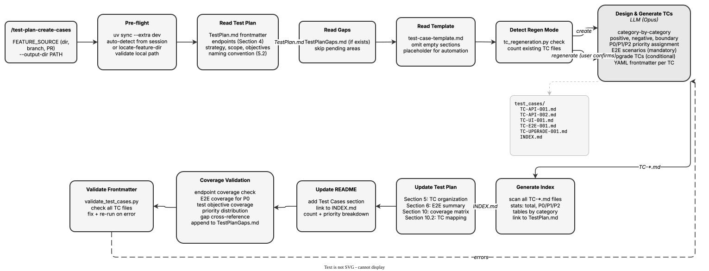

<!-- Auto-generated from registry.yaml. Do not edit directly. -->


# test-plan-create-cases

Generate individual test case specification files (TC-*.md) from an existing test plan.
Processes categories one at a time, generates E2E and optional upgrade test cases,
validates endpoint coverage, and updates the test plan with traceability data.
Supports regeneration mode for updating existing test cases.

**Plugin**: [test-plan](index.md) | **:material-check: User-invocable**

## Contract

<div class="skill-contract">
  <header class="skill-contract__header">
    <span class="skill-contract__eyebrow">Skill Contract</span>
    <span class="skill-contract__version">canonical-skill-v1</span>
  </header>
  <p class="skill-contract__lede">Convert an approved test plan into self-contained, traceable test-case specifications.</p>
  <section class="skill-contract__section" data-section="01">
    <h3 class="skill-contract__section-title"><span class="skill-contract__section-name">Identity</span></h3>
    <div class="skill-contract__row">
      <span class="skill-contract__field">Functions</span>
      <div class="skill-contract__inline">
        <span class="skill-contract__chip skill-contract__chip--function">generate</span>
      </div>
    </div>
    <div class="skill-contract__row">
      <span class="skill-contract__field">Success</span>
      <ul class="skill-contract__list">
        <li>Writes test cases and updates the index and plan coverage tables.</li>
        <li>Validates case counts, scope, objective traceability and E2E/UI interface coverage.</li>
      </ul>
    </div>
  </section>
  <section class="skill-contract__section" data-section="02">
    <h3 class="skill-contract__section-title"><span class="skill-contract__section-name">Optimization Targets</span></h3>
    <div class="skill-contract__metrics">
      <div class="skill-contract__metric">
        <code class="skill-contract__metric-id">task_success</code>
        <span class="skill-contract__measure skill-contract__measure--judge">judge</span>
        <a class="skill-contract__ref" href="https://github.com/fullsend-ai/test-creator/blob/d13995efb9bdc5b88a2c20e7f864a26fdf9ee9a0/skills/test-plan-create-cases/SKILL.md" title="fullsend-ai/test-creator@d13995efb9bdc5b88a2c20e7f864a26fdf9ee9a0:skills/test-plan-create-cases/SKILL.md">SKILL.md @ d13995e<span class="skill-contract__ref-arrow" aria-hidden="true">&#x2192;</span></a>
      </div>
    </div>
  </section>
  <section class="skill-contract__section" data-section="03">
    <h3 class="skill-contract__section-title"><span class="skill-contract__section-name">Invariants</span></h3>
    <div class="skill-contract__row">
      <span class="skill-contract__field">Must Preserve</span>
      <ul class="skill-contract__list">
        <li>Every case cites at least one plan objective and has observable expected results.</li>
        <li>Preserve flow priorities on regeneration and avoid inventing details for interfaces marked pending.</li>
      </ul>
    </div>
    <div class="skill-contract__row">
      <span class="skill-contract__field">Fixed Context</span>
      <div class="skill-contract__code">
      <div class="skill-contract__code-line"><span class="skill-contract__code-key">documents</span><span class="skill-contract__code-val">skills/test-plan-create-cases/SKILL.md, skills/test-plan-create-cases/test-case-template.md, scripts/validate.py</span></div>
      <div class="skill-contract__code-line"><span class="skill-contract__code-key">knowledge</span><span class="skill-contract__code-val">task_input<span class="skill-contract__privacy">task_private</span></span></div>
      </div>
    </div>
  </section>
  <section class="skill-contract__section" data-section="04">
    <h3 class="skill-contract__section-title"><span class="skill-contract__section-name">Traceability</span></h3>
    <div class="skill-contract__row">
      <span class="skill-contract__field">Skill</span>
      <div class="skill-contract__inline"><a class="skill-contract__path" href="https://github.com/fullsend-ai/test-creator/blob/d13995efb9bdc5b88a2c20e7f864a26fdf9ee9a0/skills/test-plan-create-cases/SKILL.md"><span class="skill-contract__ref-arrow" aria-hidden="true">&#x2197;</span><code>skills/test-plan-create-cases/SKILL.md</code></a></div>
    </div>
    <div class="skill-contract__row">
      <span class="skill-contract__field">Supporting</span>
      <ul class="skill-contract__paths">
        <li><a class="skill-contract__path" href="https://github.com/fullsend-ai/test-creator/blob/d13995efb9bdc5b88a2c20e7f864a26fdf9ee9a0/skills/test-plan-create-cases/test-case-template.md"><span class="skill-contract__ref-arrow" aria-hidden="true">&#x2197;</span><code>skills/test-plan-create-cases/test-case-template.md</code></a></li>
        <li><a class="skill-contract__path" href="https://github.com/fullsend-ai/test-creator/blob/d13995efb9bdc5b88a2c20e7f864a26fdf9ee9a0/scripts/validate.py"><span class="skill-contract__ref-arrow" aria-hidden="true">&#x2197;</span><code>scripts/validate.py</code></a></li>
      </ul>
    </div>
  </section>
</div>

## Diagram

<div class="diagram-container" markdown>

</div>

## Arguments

```bash
/test-plan-create-cases [FEATURE_SOURCE] [--output-dir PATH]
```

| Argument | Required | Default | Description |
|----------|----------|---------|-------------|
| `FEATURE_SOURCE` |  | `auto-detected from prior /test-plan-create run` | Feature directory path, GitHub branch URL, or GitHub PR URL |
| `--output-dir` |  | - | Force creation in specified directory (contributor override) |

## Usage

```bash
/test-plan-create-cases
/test-plan-create-cases mcp_catalog
/test-plan-create-cases /path/to/feature_dir
```
