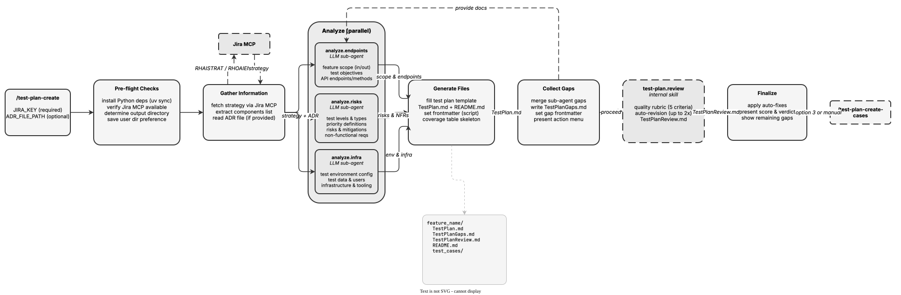

<!-- Auto-generated from registry.yaml. Do not edit directly. -->


# test-plan-create

Generate a complete test plan for a RHOAI feature from a Jira strategy
(RHAISTRAT or RHOAIENG issue), with optional ADR for additional technical depth.
Spawns 3 parallel sub-analyzers (endpoints, risks, infra), merges their findings
into a structured template, collects gaps into TestPlanGaps.md, then runs an
automated quality review with scoring and up to 2 auto-revision cycles. Produces
TestPlan.md, TestPlanGaps.md, TestPlanReview.md, and README.md in a feature directory.

**Plugin**: [test-plan](index.md) | **:material-check: User-invocable**

## Contract

<div class="skill-contract">
  <header class="skill-contract__header">
    <span class="skill-contract__eyebrow">Skill Contract</span>
    <span class="skill-contract__version">canonical-skill-v1</span>
  </header>
  <p class="skill-contract__lede">Turn a Jira strategy and optional design documents into a grounded E2E/UI test plan ready for review.</p>
  <section class="skill-contract__section" data-section="01">
    <h3 class="skill-contract__section-title"><span class="skill-contract__section-name">Identity</span></h3>
    <div class="skill-contract__row">
      <span class="skill-contract__field">Functions</span>
      <div class="skill-contract__inline">
        <span class="skill-contract__chip skill-contract__chip--function">plan</span>
        <span class="skill-contract__chip skill-contract__chip--function">generate</span>
      </div>
    </div>
    <div class="skill-contract__row">
      <span class="skill-contract__field">Success</span>
      <ul class="skill-contract__list">
        <li>Writes the test plan, source snapshot, gap report and README with valid frontmatter.</li>
        <li>Runs plan validation and the bounded review cycle, then reports the final quality verdict.</li>
      </ul>
    </div>
  </section>
  <section class="skill-contract__section" data-section="02">
    <h3 class="skill-contract__section-title"><span class="skill-contract__section-name">Optimization Targets</span></h3>
    <div class="skill-contract__metrics">
      <div class="skill-contract__metric">
        <code class="skill-contract__metric-id">task_success</code>
        <span class="skill-contract__measure skill-contract__measure--judge">judge</span>
        <a class="skill-contract__ref" href="https://github.com/fullsend-ai/test-creator/blob/d13995efb9bdc5b88a2c20e7f864a26fdf9ee9a0/skills/test-plan-review/prompts/score-agent.md" title="fullsend-ai/test-creator@d13995efb9bdc5b88a2c20e7f864a26fdf9ee9a0:skills/test-plan-review/prompts/score-agent.md">score-agent.md @ d13995e<span class="skill-contract__ref-arrow" aria-hidden="true">&#x2192;</span></a>
      </div>
    </div>
  </section>
  <section class="skill-contract__section" data-section="03">
    <h3 class="skill-contract__section-title"><span class="skill-contract__section-name">Invariants</span></h3>
    <div class="skill-contract__row">
      <span class="skill-contract__field">Must Preserve</span>
      <ul class="skill-contract__list">
        <li>Keep scope and acceptance-criteria references grounded in the supplied strategy and design documents.</li>
        <li>Generate E2E/UI planning artifacts; leave test-case generation and publishing to their separate skills.</li>
      </ul>
    </div>
    <div class="skill-contract__row">
      <span class="skill-contract__field">Fixed Context</span>
      <div class="skill-contract__code">
      <div class="skill-contract__code-line"><span class="skill-contract__code-key">documents</span><span class="skill-contract__code-val">skills/test-plan-create/SKILL.md, skills/test-plan-create/test-plan-template.md, skills/test-plan-review/prompts/score-agent.md</span></div>
      <div class="skill-contract__code-line"><span class="skill-contract__code-key">knowledge</span><span class="skill-contract__code-val">task_input<span class="skill-contract__privacy">task_private</span></span></div>
      </div>
    </div>
  </section>
  <section class="skill-contract__section" data-section="04">
    <h3 class="skill-contract__section-title"><span class="skill-contract__section-name">Traceability</span></h3>
    <div class="skill-contract__row">
      <span class="skill-contract__field">Skill</span>
      <div class="skill-contract__inline"><a class="skill-contract__path" href="https://github.com/fullsend-ai/test-creator/blob/d13995efb9bdc5b88a2c20e7f864a26fdf9ee9a0/skills/test-plan-create/SKILL.md"><span class="skill-contract__ref-arrow" aria-hidden="true">&#x2197;</span><code>skills/test-plan-create/SKILL.md</code></a></div>
    </div>
    <div class="skill-contract__row">
      <span class="skill-contract__field">Supporting</span>
      <ul class="skill-contract__paths">
        <li><a class="skill-contract__path" href="https://github.com/fullsend-ai/test-creator/blob/d13995efb9bdc5b88a2c20e7f864a26fdf9ee9a0/skills/test-plan-create/test-plan-template.md"><span class="skill-contract__ref-arrow" aria-hidden="true">&#x2197;</span><code>skills/test-plan-create/test-plan-template.md</code></a></li>
        <li><a class="skill-contract__path" href="https://github.com/fullsend-ai/test-creator/blob/d13995efb9bdc5b88a2c20e7f864a26fdf9ee9a0/skills/test-plan-review/prompts/score-agent.md"><span class="skill-contract__ref-arrow" aria-hidden="true">&#x2197;</span><code>skills/test-plan-review/prompts/score-agent.md</code></a></li>
      </ul>
    </div>
  </section>
</div>

## Diagram

<div class="diagram-container" markdown>

</div>

## Arguments

```bash
/test-plan-create <JIRA_KEY> [ADR_FILE_PATH]
```

| Argument | Required | Default | Description |
|----------|----------|---------|-------------|
| `JIRA_KEY` | :material-check: | - | Jira strategy key (RHAISTRAT-*) or issue key (RHOAIENG-*) to generate the test plan from |
| `ADR_FILE_PATH` |  | - | Local path to an ADR document (markdown, text, or PDF) for additional technical depth |
| `--output-dir` |  | - | Override output directory for test plan artifacts (skips validation) |

## Usage

```bash
/test-plan-create RHAISTRAT-400
/test-plan-create RHOAIENG-48676
/test-plan-create RHAISTRAT-400 /path/to/adr.pdf
```
