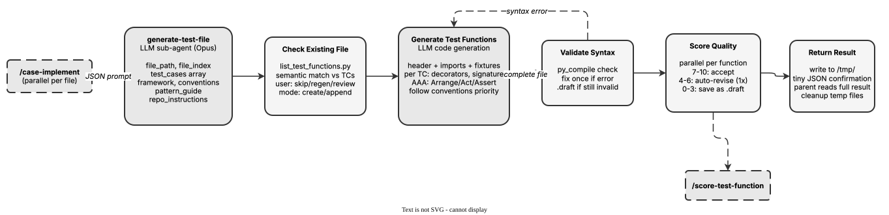

<!-- Auto-generated from registry.yaml. Do not edit directly. -->


# test-plan-generate-test-file

Internal forked sub-agent for parallel test file generation. Receives test case
data, repository conventions, and pattern guides. Generates complete test files
with framework-appropriate structure (imports, fixtures, AAA pattern functions),
validates syntax, scores quality via test-plan-score-test-function, and auto-revises
low-scoring functions. Returns result via temp file for parent to write.

**Plugin**: [test-plan](index.md) | **:material-close: Internal**

## Contract

<div class="skill-contract">
  <header class="skill-contract__header">
    <span class="skill-contract__eyebrow">Skill Contract</span>
    <span class="skill-contract__version">canonical-skill-v1</span>
  </header>
  <p class="skill-contract__lede">Produce one complete test file implementing the assigned cases while preserving existing code and repository conventions.</p>
  <section class="skill-contract__section" data-section="01">
    <h3 class="skill-contract__section-title"><span class="skill-contract__section-name">Identity</span></h3>
    <div class="skill-contract__row">
      <span class="skill-contract__field">Functions</span>
      <div class="skill-contract__inline">
        <span class="skill-contract__chip skill-contract__chip--function">generate</span>
      </div>
    </div>
    <div class="skill-contract__row">
      <span class="skill-contract__field">Success</span>
      <ul class="skill-contract__list">
        <li>Syntax-checks and quality-scores the generated file, revising it when needed.</li>
        <li>Writes the indexed temporary result JSON and returns a compact completion response to the orchestrator.</li>
      </ul>
    </div>
  </section>
  <section class="skill-contract__section" data-section="02">
    <h3 class="skill-contract__section-title"><span class="skill-contract__section-name">Optimization Targets</span></h3>
    <div class="skill-contract__metrics">
      <div class="skill-contract__metric">
        <code class="skill-contract__metric-id">task_success</code>
        <span class="skill-contract__measure skill-contract__measure--judge">judge</span>
        <a class="skill-contract__ref" href="https://github.com/fullsend-ai/test-creator/blob/d13995efb9bdc5b88a2c20e7f864a26fdf9ee9a0/skills/test-plan-score-test-function/prompts/score-test-function.md" title="fullsend-ai/test-creator@d13995efb9bdc5b88a2c20e7f864a26fdf9ee9a0:skills/test-plan-score-test-function/prompts/score-test-function.md">score-test-function.md @ d13995e<span class="skill-contract__ref-arrow" aria-hidden="true">&#x2192;</span></a>
      </div>
    </div>
  </section>
  <section class="skill-contract__section" data-section="03">
    <h3 class="skill-contract__section-title"><span class="skill-contract__section-name">Invariants</span></h3>
    <div class="skill-contract__row">
      <span class="skill-contract__field">Must Preserve</span>
      <ul class="skill-contract__list">
        <li>Do not write the destination test file; the parent skill is the code writer.</li>
        <li>Preserve existing code and avoid importing target repository dependencies.</li>
      </ul>
    </div>
    <div class="skill-contract__row">
      <span class="skill-contract__field">Fixed Context</span>
      <div class="skill-contract__code">
      <div class="skill-contract__code-line"><span class="skill-contract__code-key">documents</span><span class="skill-contract__code-val">skills/test-plan-generate-test-file/SKILL.md, skills/test-plan-score-test-function/prompts/score-test-function.md</span></div>
      <div class="skill-contract__code-line"><span class="skill-contract__code-key">knowledge</span><span class="skill-contract__code-val">task_input<span class="skill-contract__privacy">task_private</span></span></div>
      </div>
    </div>
  </section>
  <section class="skill-contract__section" data-section="04">
    <h3 class="skill-contract__section-title"><span class="skill-contract__section-name">Traceability</span></h3>
    <div class="skill-contract__row">
      <span class="skill-contract__field">Skill</span>
      <div class="skill-contract__inline"><a class="skill-contract__path" href="https://github.com/fullsend-ai/test-creator/blob/d13995efb9bdc5b88a2c20e7f864a26fdf9ee9a0/skills/test-plan-generate-test-file/SKILL.md"><span class="skill-contract__ref-arrow" aria-hidden="true">&#x2197;</span><code>skills/test-plan-generate-test-file/SKILL.md</code></a></div>
    </div>
    <div class="skill-contract__row">
      <span class="skill-contract__field">Supporting</span>
      <ul class="skill-contract__paths">
        <li><a class="skill-contract__path" href="https://github.com/fullsend-ai/test-creator/blob/d13995efb9bdc5b88a2c20e7f864a26fdf9ee9a0/skills/test-plan-score-test-function/prompts/score-test-function.md"><span class="skill-contract__ref-arrow" aria-hidden="true">&#x2197;</span><code>skills/test-plan-score-test-function/prompts/score-test-function.md</code></a></li>
      </ul>
    </div>
  </section>
</div>

## Diagram

<div class="diagram-container" markdown>

</div>

## Usage

```bash
/test-plan-generate-test-file
```
