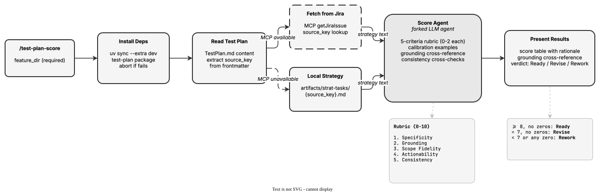

<!-- Auto-generated from registry.yaml. Do not edit directly. -->


# test-plan-publish

Publish test plan artifacts to GitHub by creating a branch, committing all files,
and opening a pull request. Validates frontmatter and artifacts before publishing.
Supports updating existing PRs (pushes new commits to the same branch). Uses
version-free branch names (test-plan/<source_key>) for iterative updates.

**Plugin**: [test-plan](index.md) | **:material-check: User-invocable**

## Contract

<div class="skill-contract">
  <header class="skill-contract__header">
    <span class="skill-contract__eyebrow">Skill Contract</span>
    <span class="skill-contract__version">canonical-skill-v1</span>
  </header>
  <p class="skill-contract__lede">Publish validated test-plan artifacts from a personal fork to a GitHub pull request in the selected test-plan repository.</p>
  <section class="skill-contract__section" data-section="01">
    <h3 class="skill-contract__section-title"><span class="skill-contract__section-name">Identity</span></h3>
    <div class="skill-contract__row">
      <span class="skill-contract__field">Functions</span>
      <div class="skill-contract__inline">
        <span class="skill-contract__chip skill-contract__chip--function">execute</span>
      </div>
    </div>
    <div class="skill-contract__row">
      <span class="skill-contract__field">Success</span>
      <ul class="skill-contract__list">
        <li>Validates the artifacts, commits and pushes the publication branch, then creates or reuses its pull request.</li>
        <li>Returns the pull-request URL and assigns reviewers when requested.</li>
      </ul>
    </div>
  </section>
  <section class="skill-contract__section" data-section="02">
    <h3 class="skill-contract__section-title"><span class="skill-contract__section-name">Optimization Targets</span></h3>
    <div class="skill-contract__metrics">
      <div class="skill-contract__metric">
        <code class="skill-contract__metric-id">task_success</code>
        <span class="skill-contract__measure skill-contract__measure--deterministic">deterministic</span>
        <span class="skill-contract__ref-placeholder"></span>
      </div>
    </div>
  </section>
  <section class="skill-contract__section" data-section="03">
    <h3 class="skill-contract__section-title"><span class="skill-contract__section-name">Invariants</span></h3>
    <div class="skill-contract__row">
      <span class="skill-contract__field">Must Preserve</span>
      <ul class="skill-contract__list">
        <li>Confirm publication with the user and require a personal fork.</li>
        <li>Never publish artifacts into the skill repository or overwrite an existing pull request title or body.</li>
      </ul>
    </div>
    <div class="skill-contract__row">
      <span class="skill-contract__field">Fixed Context</span>
      <div class="skill-contract__code">
      <div class="skill-contract__code-line"><span class="skill-contract__code-key">documents</span><span class="skill-contract__code-val">skills/test-plan-publish/SKILL.md</span></div>
      <div class="skill-contract__code-line"><span class="skill-contract__code-key">knowledge</span><span class="skill-contract__code-val">task_input<span class="skill-contract__privacy">task_private</span></span></div>
      </div>
    </div>
  </section>
  <section class="skill-contract__section" data-section="04">
    <h3 class="skill-contract__section-title"><span class="skill-contract__section-name">Traceability</span></h3>
    <div class="skill-contract__row">
      <span class="skill-contract__field">Skill</span>
      <div class="skill-contract__inline"><a class="skill-contract__path" href="https://github.com/fullsend-ai/test-creator/blob/main/skills/test-plan-publish/SKILL.md"><span class="skill-contract__ref-arrow" aria-hidden="true">&#x2197;</span><code>skills/test-plan-publish/SKILL.md</code></a></div>
    </div>
  </section>
</div>

## Diagram

<div class="diagram-container" markdown>

</div>

## Arguments

```bash
/test-plan-publish [FEATURE_SOURCE] [--repo owner/repo] [--reviewers user1,user2]
```

| Argument | Required | Default | Description |
|----------|----------|---------|-------------|
| `FEATURE_SOURCE` |  | `auto-detected from prior /test-plan-create run` | Feature directory path, GitHub branch URL, or GitHub PR URL |
| `--repo` |  | - | Target GitHub repository in owner/repo format |
| `--reviewers` |  | - | Comma-separated list of GitHub usernames to assign as PR reviewers |

## Usage

```bash
/test-plan-publish tool_calling_metadata
/test-plan-publish tool_calling_metadata --reviewers alice,bob
/test-plan-publish tool_calling_metadata --repo org/test-plans-repo
```
